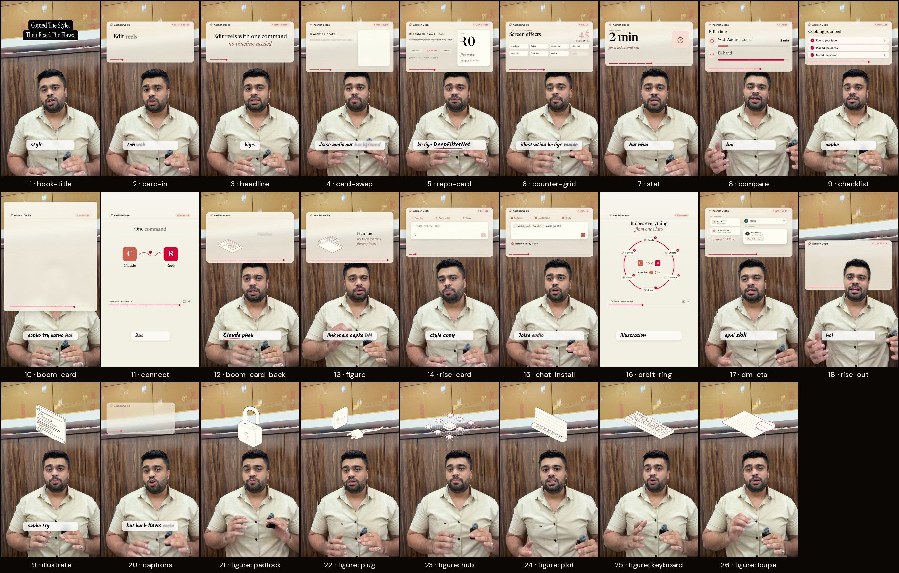
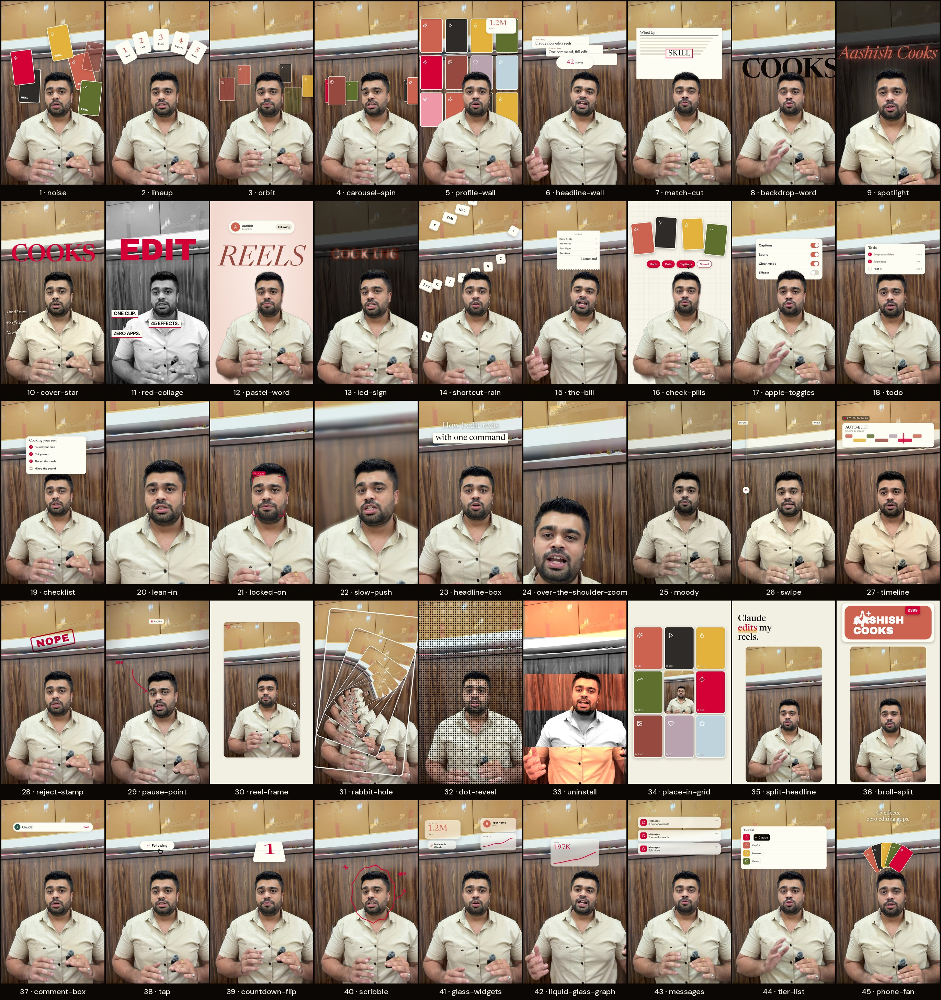

# Aashish Cooks

Turn one vertical talking video into an animated explainer reel. A product card acts out what you say, 45 screen effects play behind and around you, handwritten captions follow every word, and sounds land on every move.

**Install:** copy this folder to `~/.claude/skills/aashish-cooks`, restart Claude, drop in your video and type `/aashish-cooks auto`. The first run sets itself up (2 to 4 minutes).

## What you get

Everything below was rendered by the skill on one real clip. Ask for any of it by name.

### The cooks style: moves, cards, figures and captions
The card track is the heart of the look. Moves bring a card in and out (`rise-card`, `boom-card`, `card-swap`), and each card type acts out what you say: `at 4.6s card-swap with repo-card "my-skill", free`.



### The 45 screen effects
They sit behind, around or on top of you, like `at 9s spotlight "Cooks"`.



## Write a prompt that gives the best result

### 1. Start with auto, then refine
`/aashish-cooks auto` plans the whole reel from your words. Check the plan table, then change only what you want. One change per message is easier to follow than ten.

### 2. Give time, move, content
Say when, what, and what goes on it:

```
/aashish-cooks - 3s rise-card with repo-card "my-skill", free - at 9s spotlight "Cooks" - at 14s comment-box "Claude"
```

- Use real names: `rise-card`, `boom-card`, `card-swap`, `spotlight`, `lean-in`, `tier-list`, `comment-box`. The full list is in `references/screen-effects.md` and `references/plan-format.md`.
- Tie an effect to a word: `when I say "free", show the price`. Claude uses that word's time in your transcript.
- Ask for a `boom-card` and no card is on screen? Claude adds a `card-in` 1.5 seconds earlier and tells you.

### 3. Keep the text short
- Card and effect text should be a few words. For spotlight and backdrop-word, use one or two words.
- Separate lines with `|`: `Copied The Style.|Then Fixed The Flaws.`
- Use words you actually say. Captions keep your exact words, so Hinglish stays in Roman letters.

### 4. Match the effect to the line
| When you say | Ask for |
|---|---|
| A product, price or "it is free" | `repo-card` |
| "X works with Y" | `connect` |
| A number | `counter-grid` or `stat` |
| The big word of the reel | `spotlight`, `backdrop-word` |
| A punchline | `lean-in`, `reject-stamp` |
| A call to action | `comment-box`, `dm-cta` (always last) |
| An idea to explain | `figure` (hairline illustration) |

### 5. Do not overload it
- 2 to 4 screen effects in a 40 second reel.
- Not on the same beat as a `boom-card`.
- Never two camera effects (zoom, push, split) at the same time.
- 2 or 3 full screens per reel, each under 9 seconds. The face is the reel.

### 6. Tell Claude the language and the voice
- Say the language first: Hindi or Hinglish, Marathi, or English. Marathi read as Hindi comes out wrong.
- Say yes to voice clean-up in a noisy place. Say `strong` for roads or fans, `light` for a quiet room.

### 7. Direct the sound
- `put faaah at 8.2s`, `cash at 12s`, `add are-bapre after the number`.
- Turn a sound off: `no cash sound` (sets `"mute": ["money"]`).
- Fewer meme sounds: `meme_max 2`. More are allowed, but four is the default.

### 8. Check frames before the final render
Ask Claude to show check frames at the middle of each card and after each boom. Fix overlaps now. A final render takes about 5 to 7 seconds per second of video, and 4K is about four times slower.

## Fix only the audio
`/aashish-cooks fix-audio` leaves the picture exactly as it is and only cleans the sound: background noise out, voice polished and levelled. You get `yourvideo_audiofix.mp4` next to the original. Add `strong` for roads or fans, `light` for a quiet room:

```
/aashish-cooks fix-audio strong
```

## Shoot for a better edit
- Film vertical (9:16), with about 220 pixels of empty wall above your head. The `rise-card` needs it.
- Speak in short beats of one idea each (1.5 to 4 seconds). Each beat gets its own card.

## Add your own sounds and mascot
- **Sounds:** drop files into `sfx/custom/`. `boing.mp3` is ready as `boing`: say "put boing at 4.2s". See `sfx/custom/README.md`.
- **Mascot (optional):** none is bundled. Put your own character's images in `mascot/`, one per state (`thinking.svg`, `done.gif`). See `mascot/README.md`. Without one, the skill simply skips mascot moments.

## Licence and credits
The skill's code is MIT (`LICENSE`). Built by Aashish Bhagwat with Claude, on the work of Vibha Ramprakash (claude-video-effects), Lucas Marques (hairline), Lucide, OpenCV Zoo, Google MediaPipe, DeepFilterNet and the open font designers. Full credits and licences are in `THIRD_PARTY_NOTICES.md`. The bundled sounds are included with permission; use only sounds and artwork you have the right to use.

## How it works
Each frame is an HTML page (`engine/`) drawn in headless Chromium over your video. MediaPipe cuts you out so cards sit behind you. `scripts/cook.py` renders every frame, mixes the sounds and puts your voice back.
